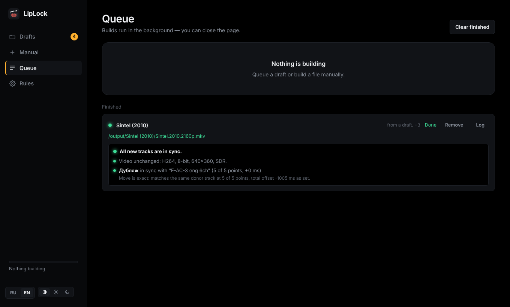

<p align="center"></p>

<h1 align="center">LipLock</h1>

<p align="center">Move audio tracks and subtitles between different versions of the same film — synced by ear.</p>

<p align="center"><a href="README.md">Русская версия</a></p>


You have a film in 4K with only English audio and an older edition with the dub you like. LipLock takes the tracks you want from one file and adds them to the other, finds the offset and frame-rate difference by matching the audio, and then listens to the finished file to make sure every new track lines up.

**Contents:** [Features](#features) · [Install](#install) · [Quick start](#quick-start) · [The draft, step by step](#the-draft-step-by-step) · [Reading the check](#reading-the-check) · [Rules and recipes](#rules-and-recipes) · [How it works](#how-it-works) · [What LipLock can't do](#what-liplock-cant-do-and-what-to-do-then) · [Variables](#variables)

## Features

- **Sync by audio.** Comparing the sound at 8 points across the film finds the offset to the millisecond and tells a stable offset from a real edit difference.
- **Frame rate differences.** 24 ↔ 23.976 is fixed by stretching timestamps without re-encoding; 25 (PAL) ↔ 23.976 is re-encoded to E-AC3 with speed and pitch corrected.
- **Different file lengths.** An extra recap, logos or a different intro at the start is just an offset: the search window grows with the length difference (up to 10 minutes). Trimmed end credits don't affect sync.
- **Badly muxed voice-overs.** Every donor track is also compared with the original inside the same donor; a voice-over muxed 190 ms late gets its own correction.
- **Two-step post-check.** The finished file is listened to: every new track is compared with the main file's original and with the same track in the donor. When a dub can't be compared with the original directly, sync is confirmed by the chain.
- **HDR and Dolby Vision untouched.** Video is copied bit for bit, and the check confirms codec, bit depth, HDR10/HLG and Dolby Vision profile match the main file.
- **Watch folder with drafts.** One folder per film with `main/` and `donors/`. LipLock ticks tracks by your rules, measures the offset and waits for you — or builds on its own when everything is reliable.
- **Whole seasons.** Episodes are paired by number (S01E02, 1x02, "серия 2"), one draft per episode.
- **One voice-over per language.** When a donor has five Russian tracks and you need one, LipLock takes the best — from your list of favourite voice-overs or by kind: dub → multi-voice → two-voice → single-voice.
- **Quick picks.** All, Audio, Subtitles and one button per language tick or untick a whole group with one click.
- **Track order.** Languages go in the order you set (for example Russian, then English); within a language the default track comes first.
- **Compatibility.** DTS, TrueHD, FLAC and PCM from donors can be replaced with E-AC3 640k, or such a copy added next to them — for Apple TV, TVs and soundbars.
- **Mux as is.** For a track already synced to this file, the sync check can be switched off with one tick.
- **Batch queue.** Queue many drafts at once, 1–4 builds in parallel.
- **Web UI** in Russian and English, dark and light themes (or following the system). The language switches on the fly, including results already measured.

## Install

### Unraid

**Community Applications** — search for LipLock in the **Apps** tab and click **Install** (once it is listed).

**Template by hand** — in the Unraid terminal:

```bash
wget -O /boot/config/plugins/dockerMan/templates-user/my-LipLock.xml \
  https://raw.githubusercontent.com/MrJosu/liplock/main/templates/liplock.xml
```

Then **Docker → Add Container → Template: LipLock**. The container only sees the folders you map:

| In the template | Inside the container | What it is |
|---|---|---|
| Library | `/media` | your film and series library |
| Library 2 (optional) | `/media2` | e.g. the downloads share |
| Watch folder | `/watch` | one folder per film with `main/` and `donors/` |
| Output folder | `/output` | results from the watch folder |
| Config | `/config` | settings, drafts, history |

Open `http://<server>:47650`. Keep the watch folder on the same share or pool as your downloads so moving files into it is instant. Update with the container's **Update** button.

### Windows

Download `LipLock-windows-x64.zip` from [Releases](https://github.com/MrJosu/liplock/releases), unzip it and run `LipLock.exe`. A console window and the interface in your browser open; keep the window open while you work. ffmpeg and MKVToolNix are bundled, files can be picked from any drive, and the interface is only reachable from that computer.

If Windows shows "Windows protected your PC", click **More info → Run anyway**: the program has no paid code signature. The watch folder defaults to `Videos\LipLock\input`, results go to `Videos\LipLock\output`.

### docker compose (Linux, NAS, Docker Desktop)

Take [`docker-compose.yml`](docker-compose.yml), set your folders and run:

```bash
docker compose up -d
```

### Any Docker host

```bash
docker run -d --name liplock -p 47650:47650 \
  -v /path/to/films:/media \
  -v /path/to/liplock/input:/watch \
  -v /path/to/liplock/output:/output \
  -v /path/to/liplock/config:/config \
  -e PUID=1000 -e PGID=1000 -e UI_LANG=en \
  ghcr.io/mrjosu/liplock:latest
```

## Quick start

Three ways — pick the one that fits.

### 1. Watch folder — for a stream of films

Create a folder per film in the watch folder and put the files in their roles:

```
/watch/
  Sintel (2010)/
    main/                 exactly one file — tracks are added to it
      Sintel.2010.2160p.mkv
    donors/               one or more files to take tracks from
      Sintel.2010.1080p.mkv
      Sintel.2010.rus.srt
```

Russian folder names `основной/` and `доноры/` work too. A minute or two later (once the files stop changing) "Sintel (2010)" appears under **Drafts**: tracks are ticked by the [rules](#rules-and-recipes) and the offset is measured. Open the draft, check it and click **Queue** — or click **Queue** right in the list if it's green. The result goes to `/output/Sintel (2010)/`; source files are never changed.

With "Build without confirmation" on, reliable drafts go straight to building — you only look at the result under **Queue**.

### 2. Manual — for one file from the library

**Manual → Main file → Choose** — the file to add tracks to. Then **Add donor** — the file to take them from. LipLock starts measuring right away; while it runs you see "Measuring the offset: listening to both files…" with a seconds counter (usually 10–60 seconds). Tick the tracks, check the result and click **Queue**. By default the result is saved next to the main file with `[+tracks]` added to the name.

### 3. A whole season

Same layout, just several episodes in `main/` — they are paired by number:

```
/watch/
  My Show S01/
    main/
      My.Show.S01E01.2160p.mkv
      My.Show.S01E02.2160p.mkv
    donors/
      my.show.s01e01.mkv
      my.show.s01e02.mkv
      my.show.s01e02.rus.srt      ← attached to the episode by its number
```

You get a draft per episode: "My Show S01 · S01E01", "My Show S01 · S01E02"… Each episode is measured on its own, so a different recap at the start of each doesn't matter. Tick **All ready** and click **Queue** — the whole season goes to building.

If the season is already in your library, skip the watch folder: **Drafts → Season from folders**, pick the folder with the main episodes and the folder with the donors.

## The draft, step by step


**Main file.** Its tracks are ticked under "Keep" — untick what should go (for example, extra languages). The "Keep: All / Audio / Subtitles / per language" buttons handle whole groups.

**Donors.** "Take" — which tracks to move. Above the table are quick picks: one click ticks the whole group, another unticks it. "Only the Russian ones", for example, is All (untick) and then Russian. The "Def." radio makes a track the default.

**Comparison.** "Compare donor track" and "with main track" — the pair the offset is measured on. **Compare original with original** (eng ↔ eng): the audio is the same, so every point matches. LipLock picks such a pair itself; if you choose different languages or different voice-overs, a hint appears. Changing the pair marks the result as outdated and highlights **Re-measure** — press it once both tracks are chosen.

**The result.** The offset in large type, the speed next to it, and a ruler with the measurement points: green points on one line mean the offset is stable across the film. Yellow points drifting away after some place mean an edit difference ([what to do](#what-liplock-cant-do-and-what-to-do-then)).

**Correction, ms.** A per-track correction on top of the donor offset. LipLock sets it when a voice-over is muxed into the donor with an offset against the donor's own original: "“Дубляж” is 191 ms late in the donor relative to the reference track — corrected."

**Offset, ms and Speed** can be edited by hand; there is a "Custom factor" for unusual frame rates. **Mux as is, no sync check** — for a track already synced to this file.

**Result.** "Save to" (next to the main file or to the output folder), the file name, what to do with DTS/TrueHD (keep, replace with E-AC3 or add a copy) and which track will be the default.

## Reading the check



After every build LipLock listens to the finished file. The check lines mean:

| Message | Meaning |
|---|---|
| "Video unchanged: HEVC, 10-bit, 3840x2160, HDR10, Dolby Vision profile 8" | The video in the result is the main file's — HDR and Dolby Vision intact |
| "in sync with “E-AC-3 eng 6ch” (5 of 5 points, +0 ms)" | The new track matches the main file's original |
| "…(3 of 5 points, +4 ms) — the other points are mostly speech…" | Also fine. A dub matches the original only on music and effects; when too few points match, LipLock measures up to 9. What matters is that the matching points agree |
| "Move is exact: matches the same donor track at 5 of 5 points, total offset -1005 ms as set" | The second check: the track in the result is exactly the donor's, with the intended offset and speed, no gaps |
| "can't be compared with the original directly, but the chain holds…" | Nothing in the main file to compare with (a commentary, say), but the donor's original matched the main file in the analysis and the move is exact — so it's in sync |
| "is 310 ms late vs …" / "early" | **Problem:** the track is offset. Check the comparison in the draft and build again |
| "Move went wrong: …the offset differs from the one set by -200 ms" | **Problem** during the build. Build again; if it repeats, open an issue |
| "Video differs from the main file: was …, now …" | **Problem:** the video in the result differs from the main file |

Problems also show in the draft list: "Built, check" instead of "Built".

## Rules and recipes

The **Rules** tab decides what LipLock ticks in drafts by itself and what happens after a build. Anything ticked by the rules can be changed in the draft.

| Rule | What it does |
|---|---|
| **Watch the folder** | New folders in the watch folder become drafts |
| **Take subtitles** | Tick donor subtitles too, not only audio |
| **What to tick in donors** | "What the main file lacks" (won't take English if it's already there) or "All audio and subtitles" |
| **Only these languages** | E.g. `rus` — only Russian tracks and subtitles are ticked in donors |
| **Remove from the main file** | E.g. `ukr` — such tracks of the main file are left out of the result |
| **Make this language default** | E.g. `rus` — the Russian track becomes the default, so the player picks it |
| **One audio track per language** | Of several voice-overs in one language, only the best one is taken |
| **Favourite voice-overs, by priority** | E.g. `Pythagoras, KvK, dub` — searched in the track name, first match wins. If nothing matches: dub → multi-voice → two-voice → single-voice, commentary last |
| **Track order in the file** | E.g. `rus, eng` — Russian first, then English |
| **Build without confirmation** | Reliable drafts go straight to building; doubtful ones wait with "Check" |
| **Parallel builds** | 1–4. On Unraid array HDDs 1 is better: parallel builds on one disk get in each other's way |
| **After a watch-folder build** | Keep the source folder or delete it after a successful build (frees space) |
| **DTS, TrueHD, FLAC, PCM from donors** | Keep as is, replace with E-AC3 640k, or add an E-AC3 copy next to it |

### Recipe 1. 4K WEB-DL + one Russian voice-over from a BDRip

The most common case: the WEB-DL has only English, the donor has several Russian voice-overs, you need one.

| Rule | Value |
|---|---|
| What to tick in donors | What the main file lacks |
| Only these languages | `rus` |
| Take subtitles | yes |
| One audio track per language | yes |
| Favourite voice-overs | your own, e.g. `Pythagoras, KvK` |
| Make this language default | `rus` |
| Track order | `rus, eng` |

From a donor with a dub, MVO, DVO and a single-voice track, one voice-over and the Russian subtitles are ticked, and that voice-over becomes the default. English stays second.

### Recipe 2. Fully automatic

Everything from recipe 1, plus:

| Rule | Value |
|---|---|
| Build without confirmation | yes |
| After a watch-folder build | Delete the source folder — once you trust the results |

Drop a folder in, get a finished file in `/output`. A draft with anything wrong never goes to building and waits for you with "Check".

### Recipe 3. Apple TV with Plex

Apple TV plays AC3 and E-AC3 itself, while Plex transcodes DTS and TrueHD on the server. Set "DTS, TrueHD, FLAC, PCM from donors" → **Add an E-AC3 copy next to it**: if the track was the default, the flag moves to the copy, and the original stays for other devices. With Infuse this isn't needed — it decodes DTS itself.

## How it works

1. **Speed.** The first two points are tested against every common frame-rate ratio; the best match wins.
2. **Offset.** Six more points are measured around the prediction. If the offset is the same everywhere, sync is reliable. A single outlier is rechecked nearby; if it still disagrees but its neighbours agree, it is reported as a false match, not as an edit.
3. **Per-track correction.** Each donor audio track is compared with the reference track of the same donor.
4. **Mux.** `mkvmerge` with `--sync` per track and `--track-order` for the language order. PAL tracks and "compatibility" tracks are re-encoded with `ffmpeg`.
5. **Post-check.** Each new track is compared with the main file's original at five points of the finished file (up to nine for a dub when too few match), then with the same track in the donor, taking the applied offset and speed into account. The video parameters are compared with the main file.

If the files differ a lot in length, the search window on the first points widens to the length difference (up to ±10 minutes), and if no match is found at the start at all, the search continues further into the film. Differences in the middle of the film (deleted or added scenes) are reported but not fixed automatically.

## What LipLock can't do, and what to do then

The usual case is the same cut of a film in two editions: they differ in offset, frame rate, intros and credits. LipLock handles that on its own. Below are the cases that need a person. LipLock notices almost all of them: the draft or the check turns yellow ("Check"), and such a file is never built silently.

| Situation | What you see | What to do |
|---|---|---|
| **Different cut in the middle:** director's vs theatrical, deleted scenes, censorship, TV version | Points on the ruler drift away after some place, status "Check" | Best: find a donor of the same cut. Otherwise fix it by hand in an audio editor (Audacity, Audition): the ruler shows where the offset changes; cut or insert silence there, then mux the result with "Mux as is" |
| **The donor has no original-language track,** only a dub | Few matching points, "Check" | Matching then relies on music and effects only. Try another pair of tracks or enter the offset by hand — the check after the build tells you whether the track lines up |
| **A dub stitched from pieces,** with the offset drifting inside it | Sync is reliable, but the check says "offset is unstable" | One correction can't fix that: use another dub or fix it in an audio editor |
| **Unusual frame rate:** 29.97 and 30 (TV versions, telecine), 50, variable | "Audio did not match", or the offset grows steadily through the film | If you know the ratio, pick "Custom factor" under "Speed". Variable frame rate can't be fixed |
| **A huge difference at the start,** more than 10 minutes | "Audio did not match" | Enter a rough offset by hand; the check confirms the result |
| **Unusual episode numbering:** absolute (1–100), double `S01E01E02`, "Part 1/2", different episode counts | Wrong pair or an episode without a pair — visible in drafts before building | Rename the files to `S01E01`, or lay such episodes out as separate films |
| **A separate subtitle file** (`.srt`, `.ass`, `.sup`) | In the draft: "Nothing to compare" | It can't be checked by audio: it is muxed with the offset from the "Offset" field (0 by default). If the subtitles were made for the donor, enter the donor's offset |
| **You want lossless or Atmos, but the donor is PAL** | The track is re-encoded to E-AC3 | Speed correction always re-encodes: up to 5.1, no Atmos. To keep the original, find a donor with the same frame rate |

What LipLock never does:

- **It doesn't touch the video.** Video always comes from the main file as is. Merging Dolby Vision or HDR10+ layers from different files is a different job (for example `dovi_tool`).
- **It only writes MKV.** If the main file is MP4, the result is still MKV.
- **It doesn't change loudness or downmix,** except when re-encoding to E-AC3 (7.1 becomes 5.1 there).
- **It doesn't search for or download tracks** — it only moves them between files you already have.

Until you have some experience with your own files, listen to a couple of spots in the first builds: the check is reliable, but your ears are more so.

## Variables

Everything below can also be changed in the UI. Variables set the defaults; what you save under **Rules** wins.

| Variable | Default | Meaning |
|---|---|---|
| `UI_LANG` | `ru` | Interface language: `ru` or `en` |
| `TRACK_ORDER` | `rus,eng` | Language order in the finished file |
| `COMPAT` | `off` | DTS/TrueHD/FLAC/PCM from donors: `off` — as is, `replace` — replace with E-AC3, `add` — add an E-AC3 copy |
| `AUTO_ENABLED` | `true` | Watch the watch folder |
| `AUTO_MODE` | `new` | What to tick in donors: `new` — what the main file lacks, `all` — everything |
| `AUTO_LANGS` | empty | Only these languages, e.g. `rus` |
| `AUTO_REMOVE_LANGS` | empty | Remove from the main file, e.g. `ukr` |
| `AUTO_DEFAULT_LANG` | empty | Default track language, e.g. `rus` |
| `AUTO_TAKE_SUBS` | `true` | Take subtitles |
| `AUTO_ONE_PER_LANG` | `false` | One audio track per language |
| `AUTO_VOICES` | empty | Favourite voice-overs, comma-separated, e.g. `Pythagoras,KvK` |
| `AUTO_BUILD` | `false` | Build without confirmation |
| `AUTO_AFTER` | `keep` | After a build: `keep` the folder or `delete` it |
| `PARALLEL` | `1` | Parallel builds, 1–4 |
| `MEDIA_DIRS` | `/media,/media2` | Folders shown in the file picker |
| `PUID` / `PGID` / `UMASK` | `99` / `100` / `000` | Owner and permissions of new files (nobody:users on Unraid) |
| `PORT` | `47650` | Web UI port |
| `POLL_SECONDS` / `STABLE_SECONDS` | `20` / `60` | How often to scan the watch folder and how many seconds files must stay unchanged before they become a draft |

## Legal

LipLock does not download anything, search the internet or bypass copy protection. It only moves tracks between files you already have. Use it with copies you own legally, for example your own discs. The examples and screenshots use the open Blender Foundation films ([Sintel](https://durian.blender.org/), [Big Buck Bunny](https://peach.blender.org/), CC BY) and synthetic test files.

## Security

There is no login. Do not expose the port to the internet — put it behind your reverse proxy with authentication (Traefik + Authelia, SWAG, NPM…) if you need remote access.

## Development

```bash
pip install flask waitress numpy
sudo apt install ffmpeg mkvtoolnix
cd app && MEDIA_DIRS=$HOME/Videos WATCH_DIR=/tmp/watch OUTPUT_DIR=/tmp/out CONFIG_DIR=/tmp/cfg python3 server.py
```

Pushing to `main` builds and publishes `ghcr.io/<owner>/liplock` (amd64 and arm64) and a Windows build via GitHub Actions. Publishing a release attaches the Windows zip to it.

Bugs and questions go to [Issues](https://github.com/MrJosu/liplock/issues).

## License

[MIT](LICENSE)
