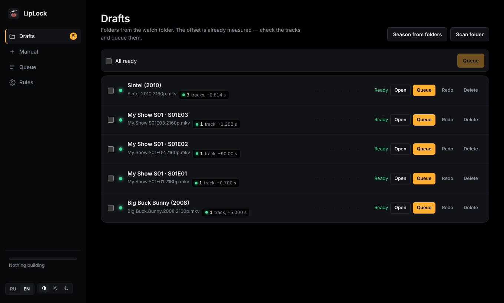
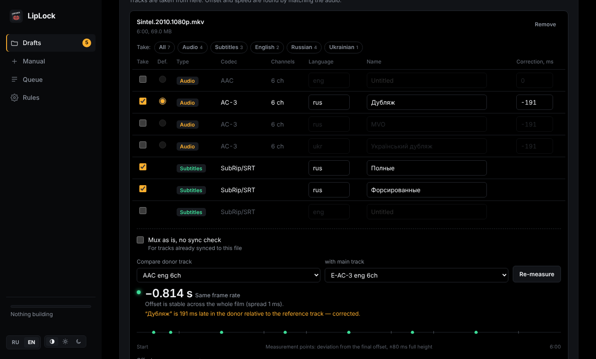

<p align="center"></p>

<h1 align="center">LipLock</h1>

<p align="center">Move audio tracks and subtitles between different versions of the same film — synced by ear.</p>

<p align="center"><a href="README.md">Русская версия</a></p>



You have a film in 4K with only English audio and an older edition with the dub you like. LipLock takes the tracks you want from one file and adds them to the other, finds the offset and frame-rate difference by matching the audio, and then listens to the finished file to make sure every new track lines up.

## Features

- **Sync by audio.** Cross-correlation at 8 points across the film finds the offset to the millisecond and tells a stable offset from a real edit difference.
- **Frame rate differences.** 24 ↔ 23.976 is fixed by stretching timestamps without re-encoding; 25 (PAL) ↔ 23.976 is re-encoded to E-AC3 with speed and pitch corrected.
- **Badly muxed voice-overs.** Every donor track is also compared to the donor's original inside the same file; a track muxed 190 ms late gets its own correction.
- **Two-step post-check.** After each build the result is listened to: every new track is compared with the main file's original, and also with the same track in the donor to confirm the move was exact (right track, offset, speed, no gaps). When a dub can't be compared with the original directly, sync is confirmed by the chain: donor original ↔ main file plus an exact move. Problems show up in the queue right away.
- **Watch folder with drafts.** One folder per film with `main/` and `donors/`. LipLock ticks tracks by your rules, measures the offset and waits for you to confirm — or builds on its own when everything is reliable.
- **Whole seasons.** Put the main episodes and the donors into two folders — LipLock pairs them by episode number (S01E02, 1x02) and makes a draft per episode. Every episode is synced on its own.
- **Different lengths.** An extra recap, logos or a different intro at the start is just an offset: the search window grows with the length difference (up to 10 minutes). Trimmed credits at the end do not affect sync.
- **HDR and Dolby Vision untouched.** Video is copied bit for bit, and the post-check confirms codec, bit depth, HDR10/HLG and the Dolby Vision profile match the main file.
- **Compatibility.** DTS, TrueHD, FLAC and PCM from donors can be replaced with E-AC3 640k, or such a copy can be added next to them. Apple TV, TVs and soundbars play E-AC3 without trouble; with "add a copy" the original stays.
- **Mux as is.** For a track already synced to this file, the sync check can be switched off with one tick.
- **Batch queue.** Queue many drafts at once, run 1–4 builds in parallel.
- **Quick picks.** Buttons above the track table — All, Audio, Subtitles and one per language — tick or untick a whole group with one click.
- **Track order.** Languages go in the order you set (for example Russian, then English); within a language the default track comes first.
- **Web UI** in dark and light themes (or following the system), in Russian and English. The language switches on the fly, including results that were already measured.



## Install

### Unraid

**Community Applications** — search for LipLock in the **Apps** tab and click **Install** (once it is listed).

**Template by hand** — in the Unraid terminal:

```bash
wget -O /boot/config/plugins/dockerMan/templates-user/my-LipLock.xml \
  https://raw.githubusercontent.com/MrJosu/liplock/main/templates/liplock.xml
```

Then **Docker → Add Container → Template: LipLock**. The container only sees the folders you map:

| In the template | Inside the container | What it is |
|---|---|---|
| Library | `/media` | your films |
| Library 2 (optional) | `/media2` | e.g. the downloads share |
| Watch folder | `/watch` | one folder per film with `main/` and `donors/` |
| Output folder | `/output` | results from the watch folder |
| Config | `/config` | settings, drafts, history |

Open `http://<server>:47650`. Keep the watch folder on the same share or pool as your downloads so moving files into it is instant.

### Windows

Download `LipLock-windows-x64.zip` from [Releases](https://github.com/MrJosu/liplock/releases), unzip it and run `LipLock.exe`. The interface opens in your browser. ffmpeg and MKVToolNix are bundled; files can be picked from any drive. The interface is only reachable from that computer.

### docker compose (Linux, NAS, Docker Desktop)

Take [`docker-compose.yml`](docker-compose.yml), set your folders and run:

```bash
docker compose up -d
```

### Any Docker host

```bash
docker run -d --name liplock -p 47650:47650 \
  -v /path/to/films:/media \
  -v /path/to/liplock/input:/watch \
  -v /path/to/liplock/output:/output \
  -v /path/to/liplock/config:/config \
  -e PUID=1000 -e PGID=1000 -e UI_LANG=en \
  ghcr.io/mrjosu/liplock:latest
```

## Watch folder layout

```
/watch/
  Sintel (2010)/
    main/                 exactly one file — tracks are added to it
      Sintel.2010.2160p.mkv
    donors/               one or more files to take tracks from
      Sintel.2010.1080p.mkv
      Sintel.2010.rus.srt
```

Russian folder names `основной/` and `доноры/` work too. The result goes to `/output/Sintel (2010)/`. Source files are never changed.

A **season** uses the same layout, just with several episodes in `main/`:

```
/watch/
  My Show S01/
    main/
      My.Show.S01E01.2160p.mkv
      My.Show.S01E02.2160p.mkv
    donors/
      my.show.s01e01.mkv
      my.show.s01e02.mkv
      bb.s01e02.rus.srt            ← attached to its episode by number
```

You get one draft per episode. If the season is already in your library, skip the watch folder: **Drafts → Season from folders**, pick the folder with the main episodes and the folder with the donors.

## How it works

1. **Speed.** The first two points are tested against every common frame-rate ratio; the best match wins.
2. **Offset.** Six more points are measured around the prediction. If the offset is the same everywhere, sync is reliable. A single outlier is rechecked nearby; if it still disagrees but its neighbours agree, it is reported as a false match, not as an edit.
3. **Per-track correction.** Each donor audio track is compared with the reference track of the same donor.
4. **Mux.** `mkvmerge` with `--sync` per track and `--track-order` for the language order. PAL tracks are re-encoded with `ffmpeg`.
5. **Post-check.** Each new track is compared with the main file's original at five points of the finished file (up to nine for a dub when too few match), then with the same track in the donor, taking the applied offset and speed into account. The video parameters (codec, bit depth, HDR, Dolby Vision) are compared with the main file.

When the files differ a lot in length, the first search window widens to the length difference (±10 minutes at most); if nothing matches near the start, the search continues further into the film.

Differences in the middle of the film (deleted or added scenes) are reported but not fixed automatically — see below.

## What LipLock can't do, and what to do then

The usual case is the same cut of a film in two editions: they differ in offset, frame rate, intros and credits. LipLock handles that on its own. Below are the cases that need a person. LipLock notices almost all of them itself: the draft or the post-check turns yellow ("Check"), and such a file is never built silently.

| Situation | What you see | What to do |
|---|---|---|
| **Different cut in the middle:** director's vs theatrical, deleted scenes, censorship, TV version | Points on the ruler drift away after some place, status "Check" | Best: find a donor of the same cut. Otherwise fix it by hand in an audio editor (Audacity, Audition): the ruler shows where the offset changes; cut or insert silence there, then mux the result with "Mux as is" |
| **The donor has no original-language track,** only a dub | Few matching points, "Check" | Matching then relies on music and effects only. Try another pair of tracks under "Compare donor track", or enter the offset by hand — the post-check still tells you whether the track lines up |
| **A dub stitched from pieces,** with the offset drifting inside it | Sync is reliable, but the post-check says "offset is unstable" for this track | One correction can't fix that: use another dub or fix it in an audio editor |
| **Unusual frame rate:** 29.97 and 30 (TV versions, telecine), 50, variable frame rate | "Audio did not match", or the offset grows steadily through the film | If you know the ratio, pick "Custom factor" under "Speed". Variable frame rate can't be fixed |
| **A huge difference at the start,** more than 10 minutes | "Audio did not match" | Enter a rough offset by hand; the post-check confirms the result |
| **Unusual episode numbering:** absolute (1–100), double episodes `S01E01E02`, "Part 1/2", different episode counts | Wrong pair or an episode without a pair — visible in drafts before building | Rename the files to `S01E01`, or lay such episodes out as separate films (`main/` + `donors/`) |
| **A separate subtitle file** (`.srt`, `.ass`, `.sup`) | In the draft: "Nothing to compare" | It can't be checked by audio: it is muxed with the offset from the "Offset" field (0 by default). If the subtitles were made for the donor, enter the donor's offset |
| **You want lossless or Atmos, but the donor is PAL** | The track is re-encoded to E-AC3 | Speed correction always re-encodes: up to 5.1, no Atmos. To keep the original, find a donor with the same frame rate (24p) — then the track is copied unchanged |

What LipLock never does:

- **It doesn't touch the video.** Video always comes from the main file as is. Merging Dolby Vision or HDR10+ layers from different files is a different job (for example `dovi_tool`).
- **It only writes MKV.** If the main file is MP4, the result is still MKV.
- **It doesn't change loudness or downmix,** except when re-encoding to E-AC3 (7.1 becomes 5.1 there).
- **It doesn't search for or download tracks** — it only moves them between files you already have.

Until you have some experience with your own files, listen to a couple of spots in the first builds: the post-check is reliable, but your ears are more so.

## Configuration

| Variable | Default | Meaning |
|---|---|---|
| `UI_LANG` | `ru` | Interface language: `ru` or `en` (also switchable in the UI) |
| `TRACK_ORDER` | `rus,eng` | Languages that go first in the finished file |
| `COMPAT` | `off` | DTS/TrueHD/FLAC/PCM from donors: `off` — as is, `replace` — replace with E-AC3, `add` — add an E-AC3 copy (also set in the UI) |
| `MEDIA_DIRS` | `/media,/media2` | Folders shown in the file picker |
| `PUID` / `PGID` / `UMASK` | `99` / `100` / `000` | Owner and permissions of new files |
| `PORT` | `47650` | Web UI port inside the container |
| `POLL_SECONDS` / `STABLE_SECONDS` | `20` / `60` | Watch-folder scan interval and how long files must stay unchanged |

Everything else lives under **Rules** in the UI.

## Legal

LipLock does not download anything, search the internet or bypass copy protection. It only moves tracks between files you already have. Use it with copies you own legally, for example your own discs. The examples and screenshots use the open Blender Foundation films ([Sintel](https://durian.blender.org/), [Big Buck Bunny](https://peach.blender.org/), CC BY) and synthetic test files.

## Security

There is no login. Do not expose the port to the internet — put it behind your reverse proxy with authentication (Traefik + Authelia, SWAG, NPM…) if you need remote access.

## Development

```bash
pip install flask waitress numpy
sudo apt install ffmpeg mkvtoolnix
cd app && MEDIA_DIRS=$HOME/Videos WATCH_DIR=/tmp/watch OUTPUT_DIR=/tmp/out CONFIG_DIR=/tmp/cfg python3 server.py
```

Pushing to `main` builds and publishes `ghcr.io/<owner>/liplock` (amd64 and arm64) and a Windows build via GitHub Actions. Tags `v*` attach the Windows zip to a release.

## License

[MIT](LICENSE)
