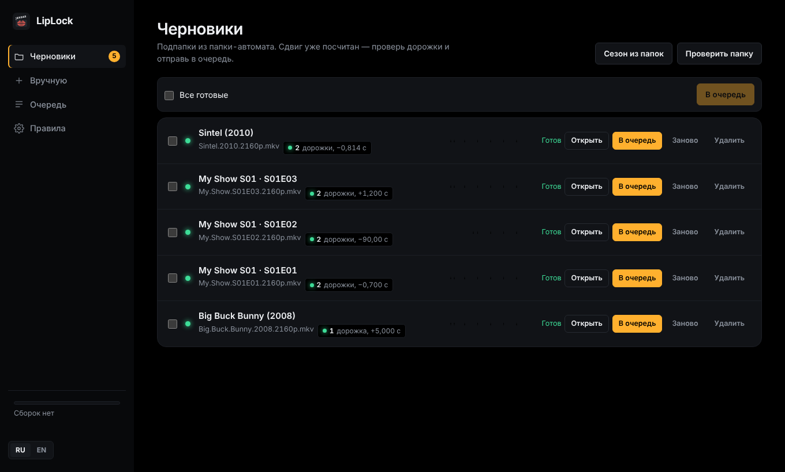
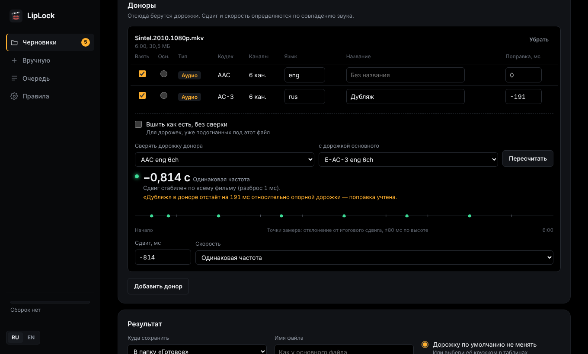

<p align="center"></p>

<h1 align="center">LipLock</h1>

<p align="center">Переносит аудиодорожки и субтитры между разными версиями одного фильма и синхронизирует их по звуку.</p>

<p align="center"><a href="README.en.md">English version</a></p>



Есть фильм в 4K только с английской дорожкой и старое издание с любимым дубляжом. LipLock берёт нужные дорожки из одного файла и добавляет в другой, сам находит сдвиг и разницу частоты кадров по совпадению звука, а после сборки слушает готовый файл и проверяет, что каждая новая дорожка легла ровно.

## Возможности

- **Синхронизация по звуку.** Кросс-корреляция в 8 точках фильма даёт сдвиг с точностью до миллисекунд и отличает стабильный сдвиг от настоящей разницы в монтаже.
- **Разная частота кадров.** 24 ↔ 23.976 исправляется растяжением таймкодов без перекодирования; 25 (PAL) ↔ 23.976 — перекодированием в E-AC3 с исправлением скорости и тона.
- **Криво вклеенные озвучки.** Каждая дорожка донора дополнительно сверяется с его же оригиналом. Дорожке, вклеенной с отставанием на 190 мс, ставится своя поправка.
- **Пост-проверка.** После сборки готовый файл слушается: каждая новая дорожка должна совпасть с оригиналом основного в 5 точках. Проблемы сразу видны в очереди.
- **Папка-автомат и черновики.** Одна подпапка на фильм, внутри `main/` и `donors/`. LipLock отмечает дорожки по правилам, считает сдвиг и ждёт подтверждения — или собирает сам, если всё надёжно.
- **Сезоны пачкой.** Положи основные серии и серии-доноры в две папки — LipLock сам составит пары по номерам (S01E02, 1x02, «серия 2») и сделает черновик на каждую серию. Каждая серия сверяется отдельно.
- **Разная длина файлов.** Лишний рекап, логотипы или другая заставка в начале — это просто сдвиг: окно поиска растёт вместе с разницей длительностей (до 10 минут). Обрезанные титры в конце на синхронизацию не влияют.
- **HDR и Dolby Vision не трогаются.** Видео переносится байт в байт, а пост-проверка подтверждает: кодек, битность, HDR10/HLG и профиль Dolby Vision в результате те же, что в основном файле.
- **Совместимость.** DTS, TrueHD, FLAC и PCM из доноров можно заменить на E-AC3 640k или добавить такую копию рядом. E-AC3 без проблем играют Apple TV, телевизоры и саундбары; оригинал остаётся, если выбрать «добавить копию».
- **Вшить как есть.** Для дорожки, которая уже подогнана под этот файл, сверку можно выключить одной галочкой.
- **Пакетная очередь.** Можно отправить много черновиков разом и собирать по 1–4 одновременно.
- **Порядок дорожек.** Языки идут в заданном порядке (например, сначала русские, потом английские), внутри языка первой идёт дорожка по умолчанию.
- **Веб-интерфейс** в тёмной теме, на русском и английском.



## Установка

### Unraid

**Через Community Applications** — найди LipLock во вкладке **Apps** и нажми **Install** (после того как приложение появится в каталоге).

**Через шаблон вручную** — в терминале Unraid:

```bash
wget -O /boot/config/plugins/dockerMan/templates-user/my-LipLock.xml \
  https://raw.githubusercontent.com/MrJosu/liplock/main/templates/liplock.xml
```

Затем **Docker → Add Container → Template: LipLock**. Контейнер видит только подключённые папки:

| В шаблоне | В контейнере | Что это |
|---|---|---|
| Library | `/media` | фильмы |
| Library 2 (необязательно) | `/media2` | например, папка загрузок |
| Watch folder | `/watch` | по подпапке на фильм с `main/` и `donors/` |
| Output folder | `/output` | результаты из папки-автомата |
| Config | `/config` | настройки, черновики, история |

Интерфейс — `http://<сервер>:47650`. Папку-автомат лучше держать на том же шаре или пуле, что и загрузки, — тогда перенос файлов в неё мгновенный.

### Windows

Скачай `LipLock-windows-x64.zip` со страницы [Releases](https://github.com/MrJosu/liplock/releases), распакуй и запусти `LipLock.exe`. Откроется браузер с интерфейсом. ffmpeg и MKVToolNix уже внутри, файлы выбираются с любого диска. Интерфейс доступен только с этого компьютера.

### docker compose (Linux, NAS, Docker Desktop)

Возьми [`docker-compose.yml`](docker-compose.yml), поправь пути к папкам и запусти:

```bash
docker compose up -d
```

### Любой Docker

```bash
docker run -d --name liplock -p 47650:47650 \
  -v /путь/к/фильмам:/media \
  -v /путь/к/liplock/input:/watch \
  -v /путь/к/liplock/output:/output \
  -v /путь/к/liplock/config:/config \
  -e PUID=1000 -e PGID=1000 \
  ghcr.io/mrjosu/liplock:latest
```

## Как раскладывать файлы

```
/watch/
  Sintel (2010)/
    main/                 ровно один файл — в него добавляются дорожки
      Sintel.2010.2160p.mkv
    donors/               один или несколько файлов, откуда берутся дорожки
      Sintel.2010.1080p.mkv
      Sintel.2010.rus.srt
```

Можно называть и по-русски: `основной/` и `доноры/`. Результат — в `/output/Sintel (2010)/`. Исходные файлы не меняются.

**Сезон** раскладывается так же, только серий в `main/` несколько:

```
/watch/
  My Show S01/
    main/
      My.Show.S01E01.2160p.mkv
      My.Show.S01E02.2160p.mkv
    donors/
      my.show.s01e01.mkv
      my.show.s01e02.mkv
      my.show.s01e02.rus.srt            ← к серии привяжется по номеру
```

Получится черновик на каждую серию. Если сезон уже лежит в медиатеке, папку-автомат можно не трогать: **Черновики → Сезон из папок**, выбери папку с основными сериями и папку с донорами.

## Как это работает

1. **Скорость.** На первых двух точках перебираются типичные соотношения частоты кадров, побеждает лучшее совпадение.
2. **Сдвиг.** Ещё шесть точек меряются вокруг прогноза. Если сдвиг везде одинаковый, синхронизация надёжная. Одиночный выброс перепроверяется рядом; если он всё равно не сходится, но соседи согласны, это помечается как ложное совпадение, а не монтаж.
3. **Поправки дорожек.** Каждая аудиодорожка донора сверяется с опорной дорожкой того же донора.
4. **Сборка.** `mkvmerge` со своим `--sync` для каждой дорожки и `--track-order` для порядка языков. PAL-дорожки перекодируются через `ffmpeg`.
5. **Пост-проверка.** Каждая новая дорожка сравнивается с оригиналом основного файла в пяти точках готового файла, а параметры видео (кодек, битность, HDR, Dolby Vision) — с основным файлом.

Если файлы сильно отличаются длиной, окно поиска на первых точках расширяется до разницы длительностей (максимум ±10 минут), а если в начале звук не нашёлся вовсе — поиск продолжается дальше по фильму.

Разница в середине фильма (вырезанные или добавленные сцены) обнаруживается, но автоматически не исправляется — подробнее ниже.

## Чего LipLock не умеет и что тогда делать

Обычный случай — одна и та же версия фильма в двух изданиях: отличаются сдвиг, частота кадров, заставки и титры. Его LipLock собирает сам. Ниже случаи, где нужен человек. Почти все из них LipLock замечает сам: черновик или пост-проверка получают жёлтый статус «Проверь», и молча такой файл не собирается.

| Ситуация | Как это выглядит | Что делать |
|---|---|---|
| **Разный монтаж в середине:** режиссёрская и прокатная версии, вырезанные сцены, цензура, ТВ-версия | Точки на линейке после какого-то места уходят в сторону, статус «Проверь» | Лучше всего найти донор той же версии. Иначе — свести вручную в аудиоредакторе (Audacity, Audition): по линейке видно, где меняется сдвиг; там вырезать кусок или вставить тишину, а готовую дорожку вшить с галочкой «Вшить как есть» |
| **В доноре нет оригинальной дорожки,** только перевод | Мало совпавших точек, «Проверь» | Сверка идёт только по музыке и шумам. Попробуй другую пару дорожек в «Сверять дорожку донора» или впиши сдвиг вручную — пост-проверка после сборки всё равно скажет, легла ли дорожка |
| **Озвучка собрана из кусков,** и сдвиг внутри неё плавает | Сверка надёжная, но пост-проверка пишет про эту дорожку «сдвиг непостоянный» | Одной поправкой такое не исправить: возьми другую озвучку или правь вручную в аудиоредакторе |
| **Нестандартная частота кадров:** 29.97 и 30 (ТВ-версии, телесин), 50, переменная частота | «Звук не совпал» или сдвиг равномерно растёт по фильму | Если соотношение известно — выбери «Свой множитель» в поле «Скорость». Переменную частоту кадров LipLock не исправит |
| **Огромная разница в начале,** больше 10 минут | «Звук не совпал» | Впиши примерный сдвиг вручную; пост-проверка подтвердит результат |
| **Необычная нумерация серий:** сквозная (1–100), двойные серии `S01E01E02`, «Part 1/2», разное число серий | Не та пара или серия без пары — видно в черновиках до сборки | Переименуй файлы в `S01E01` или разложи такие серии как отдельные фильмы (`main/` + `donors/`) |
| **Отдельный файл субтитров** (`.srt`, `.ass`, `.sup`) | В черновике: «Сверять не по чему» | По звуку его не проверить: он вшивается со сдвигом из поля «Сдвиг» (по умолчанию 0). Если субтитры сделаны под донор, впиши тот же сдвиг, что у донора |
| **Нужен lossless или Atmos, а донор PAL** | Дорожка перекодирована в E-AC3 | При исправлении скорости звук всегда перекодируется: максимум 5.1, без Atmos. Чтобы сохранить оригинал, ищи донор с той же частотой кадров (24p) — тогда дорожка копируется без изменений |

Чего LipLock не делает в принципе:

- **Не трогает видео.** Видео всегда берётся из основного файла как есть. Объединить слои Dolby Vision или HDR10+ из разных файлов — другая задача (например, `dovi_tool`).
- **Собирает только MKV.** Если основной файл MP4, результат всё равно будет MKV.
- **Не правит громкость и не сводит каналы,** кроме перекодирования в E-AC3 (там 7.1 сводится в 5.1).
- **Не ищет и не скачивает дорожки** — только переносит между файлами, которые у тебя уже есть.

Пока не набралось опыта на своих файлах, послушай пару мест в первых сборках: пост-проверка надёжна, но уши надёжнее.

## Настройки

| Переменная | По умолчанию | Что это |
|---|---|---|
| `UI_LANG` | `ru` | Язык интерфейса: `ru` или `en` (переключается и в интерфейсе) |
| `TRACK_ORDER` | `rus,eng` | Языки, которые идут первыми в готовом файле |
| `COMPAT` | `off` | DTS/TrueHD/FLAC/PCM из доноров: `off` — как есть, `replace` — заменить на E-AC3, `add` — добавить копию в E-AC3 (меняется и в интерфейсе) |
| `MEDIA_DIRS` | `/media,/media2` | Папки в окне выбора файлов |
| `PUID` / `PGID` / `UMASK` | `99` / `100` / `000` | Владелец и права новых файлов |
| `POLL_SECONDS` / `STABLE_SECONDS` | `20` / `60` | Как часто смотреть в папку-автомат и сколько файлы должны не меняться |

Остальное — во вкладке **Правила**.

## Законность

LipLock ничего не скачивает, не ищет в интернете и не обходит защиту от копирования. Он только перекладывает дорожки между файлами, которые уже лежат у тебя. Используй его с копиями, которые у тебя есть законно, — например, со своими дисками. В примерах и на скриншотах — открытые фильмы Blender Foundation ([Sintel](https://durian.blender.org/), [Big Buck Bunny](https://peach.blender.org/), лицензия CC BY) и синтетические тестовые файлы.

## Безопасность

Входа по паролю нет. Не открывай порт в интернет — для удалённого доступа поставь за обратный прокси с авторизацией (Traefik + Authelia, SWAG, NPM…).

## Лицензия

[MIT](LICENSE)
