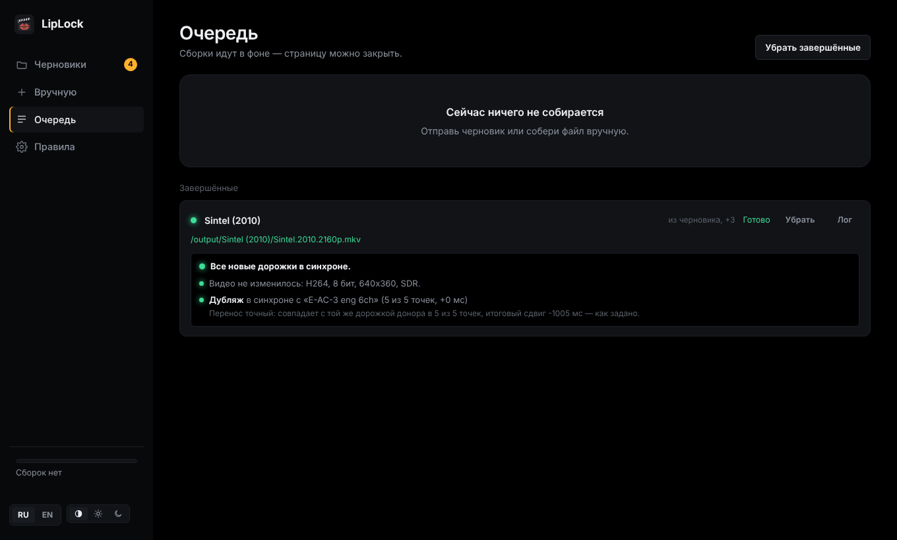

<p align="center"></p>

<h1 align="center">LipLock</h1>

<p align="center">Переносит аудиодорожки и субтитры между разными версиями одного фильма и синхронизирует их по звуку.</p>

<p align="center"><a href="README.en.md">English version</a></p>


Есть фильм в 4K только с английской дорожкой и старое издание с любимым дубляжом. LipLock берёт нужные дорожки из одного файла и добавляет в другой, сам находит сдвиг и разницу частоты кадров по совпадению звука, а после сборки слушает готовый файл и проверяет, что каждая новая дорожка легла ровно.

**Содержание:** [Возможности](#возможности) · [Установка](#установка) · [Быстрый старт](#быстрый-старт) · [Черновик шаг за шагом](#черновик-шаг-за-шагом) · [Как читать проверку](#как-читать-проверку) · [Правила и готовые рецепты](#правила-и-готовые-рецепты) · [Как это работает](#как-это-работает) · [Чего LipLock не умеет](#чего-liplock-не-умеет-и-что-тогда-делать) · [Переменные](#переменные)

## Возможности

- **Синхронизация по звуку.** Сравнение звука в 8 точках фильма даёт сдвиг с точностью до миллисекунд и отличает стабильный сдвиг от настоящей разницы в монтаже.
- **Разная частота кадров.** 24 ↔ 23.976 исправляется растяжением таймкодов без перекодирования; 25 (PAL) ↔ 23.976 — перекодированием в E-AC3 с исправлением скорости и тона.
- **Разная длина файлов.** Лишний рекап, логотипы или другая заставка в начале — это просто сдвиг: окно поиска растёт вместе с разницей длительностей (до 10 минут). Обрезанные титры в конце на синхронизацию не влияют.
- **Криво вклеенные озвучки.** Каждая дорожка донора дополнительно сверяется с оригиналом того же донора. Озвучке, вклеенной с отставанием на 190 мс, ставится своя поправка.
- **Пост-проверка в два шага.** Готовый файл слушается: каждая новая дорожка сверяется с оригиналом основного файла и с той же дорожкой в доноре. Если дубляж с оригиналом напрямую не сравнить, синхронность подтверждается цепочкой.
- **HDR и Dolby Vision не трогаются.** Видео переносится байт в байт, а проверка подтверждает: кодек, битность, HDR10/HLG и профиль Dolby Vision те же, что в основном файле.
- **Папка-автомат и черновики.** Одна подпапка на фильм, внутри `main/` и `donors/`. LipLock сам отмечает дорожки по правилам, считает сдвиг и ждёт подтверждения — или собирает сам, если всё надёжно.
- **Сезоны пачкой.** Серии сами составляют пары по номерам (S01E02, 1x02, «серия 2»), на каждую серию — свой черновик.
- **Одна озвучка на язык.** Если в доноре пять русских дорожек, а нужна одна, LipLock возьмёт лучшую — по твоему списку любимых озвучек или по типу: дубляж → многоголосая → двухголосая → авторская.
- **Быстрые отметки.** Кнопки «Все», «Аудио», «Субтитры» и по каждому языку отмечают или снимают целую группу дорожек одним нажатием.
- **Порядок дорожек.** Языки идут в заданном порядке (например, сначала русские, потом английские), внутри языка первой идёт дорожка по умолчанию.
- **Совместимость.** DTS, TrueHD, FLAC и PCM из доноров можно заменить на E-AC3 640k или добавить такую копию рядом — для Apple TV, телевизоров и саундбаров.
- **Вшить как есть.** Для дорожки, которая уже подогнана под этот файл, сверку можно выключить одной галочкой.
- **Пакетная очередь.** Много черновиков разом, по 1–4 сборки одновременно.
- **Веб-интерфейс** на русском и английском, в тёмной и светлой теме (или как в системе). Язык переключается на лету — вместе с уже посчитанными результатами.

## Установка

### Unraid

**Через Community Applications** — найди LipLock во вкладке **Apps** и нажми **Install** (после того как приложение появится в каталоге).

**Через шаблон вручную** — в терминале Unraid:

```bash
wget -O /boot/config/plugins/dockerMan/templates-user/my-LipLock.xml \
  https://raw.githubusercontent.com/MrJosu/liplock/main/templates/liplock.xml
```

Затем **Docker → Add Container → Template: LipLock**. Контейнер видит только подключённые папки:

| В шаблоне | В контейнере | Что это |
|---|---|---|
| Library | `/media` | медиатека с фильмами и сериалами |
| Library 2 (необязательно) | `/media2` | например, папка загрузок |
| Watch folder | `/watch` | папка-автомат: по подпапке на фильм с `main/` и `donors/` |
| Output folder | `/output` | результаты из папки-автомата |
| Config | `/config` | настройки, черновики, история |

Интерфейс — `http://<сервер>:47650`. Папку-автомат держи на том же шаре или пуле, что и загрузки, — тогда перенос файлов в неё мгновенный, без копирования. Обновление — кнопкой **Update** у контейнера.

### Windows

Скачай `LipLock-windows-x64.zip` со страницы [Releases](https://github.com/MrJosu/liplock/releases), распакуй и запусти `LipLock.exe`. Откроется окно консоли и браузер с интерфейсом; окно не закрывай, пока работаешь. ffmpeg и MKVToolNix уже внутри, файлы выбираются с любого диска, интерфейс доступен только с этого компьютера.

Если Windows покажет «Система Windows защитила ваш компьютер» — нажми **Подробнее → Выполнить в любом случае**: у программы нет платной цифровой подписи. Папка-автомат по умолчанию — `Видео\LipLock\input`, результаты — `Видео\LipLock\output`.

### docker compose (Linux, NAS, Docker Desktop)

Возьми [`docker-compose.yml`](docker-compose.yml), поправь пути к папкам и запусти:

```bash
docker compose up -d
```

### Любой Docker

```bash
docker run -d --name liplock -p 47650:47650 \
  -v /путь/к/фильмам:/media \
  -v /путь/к/liplock/input:/watch \
  -v /путь/к/liplock/output:/output \
  -v /путь/к/liplock/config:/config \
  -e PUID=1000 -e PGID=1000 \
  ghcr.io/mrjosu/liplock:latest
```

## Быстрый старт

Есть три способа — выбирай под задачу.

### 1. Папка-автомат — для потока фильмов

Создай в папке-автомате подпапку на фильм и разложи файлы по ролям:

```
/watch/
  Sintel (2010)/
    main/                 ровно один файл — в него добавляются дорожки
      Sintel.2010.2160p.mkv
    donors/               один или несколько файлов, откуда берутся дорожки
      Sintel.2010.1080p.mkv
      Sintel.2010.rus.srt
```

Папки можно называть и по-русски: `основной/` и `доноры/`. Через минуту-две (когда файлы перестанут меняться) во вкладке **Черновики** появится «Sintel (2010)»: дорожки уже отмечены по [правилам](#правила-и-готовые-рецепты), сдвиг посчитан. Открой черновик, проверь и нажми **В очередь** — или сразу **В очередь** в списке, если зелёный. Результат — в `/output/Sintel (2010)/`, исходные файлы не меняются.

Если включено «Собирать без подтверждения», надёжные черновики уходят в сборку сами — тебе остаётся только посмотреть результат в **Очереди**.

### 2. Вручную — для одного файла из медиатеки

**Вручную → Основной файл → Выбрать** — укажи файл, в который нужно добавить дорожки. Затем **Добавить донор** — файл, откуда их брать. LipLock сразу начнёт считать сдвиг: пока идёт расчёт, виден блок «Считаю сдвиг: слушаю оба файла…» со счётчиком секунд (обычно 10–60 секунд). Отметь дорожки, проверь результат и нажми **В очередь**. По умолчанию готовый файл кладётся рядом с основным с припиской `[+tracks]`.

### 3. Сезон целиком

Раскладка такая же, только серий в `main/` несколько — пары составятся по номерам:

```
/watch/
  My Show S01/
    main/
      My.Show.S01E01.2160p.mkv
      My.Show.S01E02.2160p.mkv
    donors/
      my.show.s01e01.mkv
      my.show.s01e02.mkv
      my.show.s01e02.rus.srt      ← к серии привяжется по номеру
```

Получится черновик на каждую серию: «My Show S01 · S01E01», «My Show S01 · S01E02»… Каждая серия сверяется отдельно, так что разный рекап в начале серий не мешает. Отметь **Все готовые** и нажми **В очередь** — весь сезон уйдёт в сборку.

Если сезон уже лежит в медиатеке, папку-автомат можно не трогать: **Черновики → Сезон из папок**, выбери папку с основными сериями и папку с донорами.

## Черновик шаг за шагом


**Основной файл.** Его дорожки отмечены галочкой «Оставить» — сними её с того, что нужно убрать (например, лишние языки). Кнопки «Оставить: Все / Аудио / Субтитры / по языку» снимают и ставят целые группы.

**Доноры.** Галочка «Взять» — какие дорожки перенести. Над таблицей — быстрые отметки: одно нажатие отмечает всю группу, повторное снимает. Например, «оставить только русское» — это «Все» (снять) и «Русский». Кружок «Осн.» делает дорожку дорожкой по умолчанию.

**Сверка.** «Сверять дорожку донора» и «с дорожкой основного» — по какой паре считается сдвиг. **Сверяй оригинал с оригиналом** (eng ↔ eng): звук у них одинаковый, поэтому совпадают все точки. LipLock выбирает такую пару сам; если выбрать разные языки или разные озвучки, появится подсказка. При смене пары результат помечается устаревшим, а кнопка **Пересчитать** подсвечивается — нажми её, когда выберешь обе дорожки.

**Результат сверки.** Сдвиг крупно, скорость рядом и линейка с точками замера: зелёные точки на одной линии — сдвиг стабильный по всему фильму. Жёлтые точки, ушедшие в сторону после какого-то места, — разница в монтаже ([что делать](#чего-liplock-не-умеет-и-что-тогда-делать)).

**Поправка, мс.** Своя поправка дорожки к общему сдвигу. LipLock ставит её сам, если озвучка вклеена в донор со сдвигом относительно его же оригинала: «„Дубляж“ в доноре отстаёт на 191 мс относительно опорной дорожки — поправка учтена».

**Сдвиг, мс и Скорость** можно поправить руками; для нестандартной частоты кадров есть «Свой множитель». **Вшить как есть, без сверки** — для дорожки, которая уже подогнана под этот файл.

**Результат сборки.** «Куда сохранить» (рядом с основным или в папку «Готовое»), имя файла, что делать с DTS/TrueHD (оставить, заменить на E-AC3 или добавить копию) и какая дорожка будет по умолчанию.

## Как читать проверку



После каждой сборки LipLock слушает готовый файл. Строки проверки значат вот что:

| Сообщение | Что значит |
|---|---|
| «Видео не изменилось: HEVC, 10 бит, 3840x2160, HDR10, Dolby Vision профиль 8» | Видео в результате то же, что в основном файле — HDR и Dolby Vision целы |
| «в синхроне с „E-AC-3 eng 6ch“ (5 из 5 точек, +0 мс)» | Новая дорожка совпала с оригиналом основного файла |
| «…(3 из 5 точек, +4 мс) — в остальных точках в основном речь…» | Тоже хорошо. Дубляж с оригиналом совпадает только по музыке и шумам; при нехватке совпадений LipLock меряет до 9 точек. Важно, что совпавшие точки показывают одно и то же |
| «Перенос точный: совпадает с той же дорожкой донора в 5 из 5 точек, итоговый сдвиг −1005 мс — как задано» | Вторая сверка: дорожка в результате — ровно та, что в доноре, со сдвигом и скоростью, которые задумывались, без обрывов |
| «напрямую с оригиналом не сравнить, но цепочка сходится…» | Дорожку не с чем сравнить в основном файле (например, комментарий), но оригинал донора совпал с основным при анализе, а перенос точный — значит, синхронно |
| «звук опаздывает на 310 мс» / «спешит на …» | **Проблема:** дорожка легла со сдвигом. Проверь сверку в черновике и пересобери |
| «Перенос с ошибкой: …сдвиг отличается от заданного на −200 мс» | **Проблема** при сборке. Пересобери; если повторяется — напиши в Issues |
| «Видео отличается от основного: было …, стало …» | **Проблема:** видео в результате отличается от основного |

Проблемы видны и в списке черновиков: статус «Собран, проверь» вместо «Собран».

## Правила и готовые рецепты

Вкладка **Правила** решает, что LipLock сам отметит в черновиках и что сделает после сборки. Всё, что отмечено по правилам, в черновике можно поменять.

| Правило | Что делает |
|---|---|
| **Следить за папкой** | Новые подпапки папки-автомата превращаются в черновики |
| **Брать субтитры** | Отмечать в донорах и субтитры, а не только аудио |
| **Что отмечать в донорах** | «То, чего нет в основном файле» (не возьмёт английскую, если она уже есть) или «Все аудио и субтитры» |
| **Только эти языки** | Например, `rus` — из доноров отмечаются только русские дорожки и субтитры |
| **Убирать из основного** | Например, `ukr` — такие дорожки основного файла не попадут в результат |
| **Ставить по умолчанию язык** | Например, `rus` — русская дорожка станет дорожкой по умолчанию, плеер включит её сам |
| **Одна аудиодорожка на язык** | Из нескольких озвучек на одном языке берётся одна, лучшая |
| **Любимые озвучки, по приоритету** | Например, `Пифагор, KvK, дубляж` — ищется в названии дорожки, побеждает первое совпадение. Если ничего не совпало: дубляж → многоголосая → двухголосая → авторская, комментарии в конце |
| **Порядок дорожек в файле** | Например, `rus, eng` — сначала русские, потом английские |
| **Собирать без подтверждения** | Надёжные черновики сразу уходят в сборку; сомнительные ждут со статусом «Проверь» |
| **Сборок одновременно** | 1–4. На HDD массива Unraid лучше 1: параллельные сборки на одном диске мешают друг другу |
| **После сборки из папки-автомата** | Оставить исходную подпапку или удалить её после успешной сборки (освобождает место) |
| **DTS, TrueHD, FLAC, PCM из доноров** | Оставить как есть, заменить на E-AC3 640k или добавить копию в E-AC3 рядом |

### Рецепт 1. 4K WEB-DL + одна русская озвучка из BDRip

Самый частый случай: в WEB-DL только английский, в доноре несколько русских озвучек, нужна одна.

| Правило | Значение |
|---|---|
| Что отмечать в донорах | То, чего нет в основном файле |
| Только эти языки | `rus` |
| Брать субтитры | да |
| Одна аудиодорожка на язык | да |
| Любимые озвучки | свои, например `Пифагор, KvK` |
| Ставить по умолчанию язык | `rus` |
| Порядок дорожек | `rus, eng` |

Из донора с дубляжом, MVO, DVO и авторской отметится одна озвучка и русские субтитры, она же станет дорожкой по умолчанию. Английская останется второй.

### Рецепт 2. Полный автомат

Всё из рецепта 1, плюс:

| Правило | Значение |
|---|---|
| Собирать без подтверждения | да |
| После сборки из папки-автомата | Удалить исходную подпапку — когда уже доверяешь результатам |

Положил папку — получил готовый файл в `/output`. Черновик, в котором что-то не так, в сборку не уйдёт и будет ждать тебя со статусом «Проверь».

### Рецепт 3. Apple TV через Plex

Apple TV воспроизводит AC3 и E-AC3 сам, а DTS и TrueHD Plex будет перекодировать на сервере. Поставь «DTS, TrueHD, FLAC, PCM из доноров» → **Добавить копию в E-AC3 рядом**: если дорожка была по умолчанию, этот флаг переходит на копию, а оригинал остаётся для других устройств. С Infuse это не нужно — он декодирует DTS сам.

## Как это работает

1. **Скорость.** На первых двух точках перебираются типичные соотношения частоты кадров, побеждает лучшее совпадение.
2. **Сдвиг.** Ещё шесть точек меряются вокруг прогноза. Если сдвиг везде одинаковый, синхронизация надёжная. Одиночный выброс перепроверяется рядом; если он всё равно не сходится, но соседи согласны, это помечается как ложное совпадение, а не монтаж.
3. **Поправки дорожек.** Каждая аудиодорожка донора сверяется с опорной дорожкой того же донора.
4. **Сборка.** `mkvmerge` со своим `--sync` для каждой дорожки и `--track-order` для порядка языков. PAL-дорожки и дорожки «для совместимости» перекодируются через `ffmpeg`.
5. **Пост-проверка.** Каждая новая дорожка сравнивается с оригиналом основного файла в пяти точках готового файла (у дубляжа при нехватке совпадений — до девяти), а затем с той же дорожкой в доноре с учётом заданных сдвига и скорости. Параметры видео сверяются с основным файлом.

Если файлы сильно отличаются длиной, окно поиска на первых точках расширяется до разницы длительностей (максимум ±10 минут), а если в начале звук не нашёлся вовсе — поиск продолжается дальше по фильму. Разница в середине фильма (вырезанные или добавленные сцены) обнаруживается, но автоматически не исправляется.

## Чего LipLock не умеет и что тогда делать

Обычный случай — одна и та же версия фильма в двух изданиях: отличаются сдвиг, частота кадров, заставки и титры. Его LipLock собирает сам. Ниже случаи, где нужен человек. Почти все из них LipLock замечает: черновик или проверка получают жёлтый статус «Проверь», и молча такой файл не собирается.

| Ситуация | Как это выглядит | Что делать |
|---|---|---|
| **Разный монтаж в середине:** режиссёрская и прокатная версии, вырезанные сцены, цензура, ТВ-версия | Точки на линейке после какого-то места уходят в сторону, статус «Проверь» | Лучше всего найти донор той же версии. Иначе — свести вручную в аудиоредакторе (Audacity, Audition): по линейке видно, где меняется сдвиг; там вырезать кусок или вставить тишину, а готовую дорожку вшить с галочкой «Вшить как есть» |
| **В доноре нет оригинальной дорожки,** только перевод | Мало совпавших точек, «Проверь» | Сверка идёт только по музыке и шумам. Попробуй другую пару дорожек или впиши сдвиг вручную — проверка после сборки скажет, легла ли дорожка |
| **Озвучка собрана из кусков,** и сдвиг внутри неё плавает | Сверка надёжная, но проверка пишет «сдвиг непостоянный» | Одной поправкой такое не исправить: возьми другую озвучку или правь вручную в аудиоредакторе |
| **Нестандартная частота кадров:** 29.97 и 30 (ТВ-версии, телесин), 50, переменная | «Звук не совпал» или сдвиг равномерно растёт по фильму | Если соотношение известно — «Свой множитель» в поле «Скорость». Переменную частоту кадров LipLock не исправит |
| **Огромная разница в начале,** больше 10 минут | «Звук не совпал» | Впиши примерный сдвиг вручную; проверка подтвердит результат |
| **Необычная нумерация серий:** сквозная (1–100), двойные `S01E01E02`, «Part 1/2», разное число серий | Не та пара или серия без пары — видно в черновиках до сборки | Переименуй файлы в `S01E01` или разложи такие серии как отдельные фильмы |
| **Отдельный файл субтитров** (`.srt`, `.ass`, `.sup`) | В черновике: «Сверять не по чему» | По звуку его не проверить: он вшивается со сдвигом из поля «Сдвиг» (по умолчанию 0). Если субтитры сделаны под донор, впиши сдвиг донора |
| **Нужен lossless или Atmos, а донор PAL** | Дорожка перекодирована в E-AC3 | При исправлении скорости звук всегда перекодируется: максимум 5.1, без Atmos. Чтобы сохранить оригинал, ищи донор с той же частотой кадров |

Чего LipLock не делает в принципе:

- **Не трогает видео.** Видео всегда берётся из основного файла как есть. Объединить слои Dolby Vision или HDR10+ из разных файлов — другая задача (например, `dovi_tool`).
- **Собирает только MKV.** Если основной файл MP4, результат всё равно будет MKV.
- **Не правит громкость и не сводит каналы,** кроме перекодирования в E-AC3 (там 7.1 сводится в 5.1).
- **Не ищет и не скачивает дорожки** — только переносит между файлами, которые у тебя уже есть.

Пока не набралось опыта на своих файлах, послушай пару мест в первых сборках: проверка надёжна, но уши надёжнее.

## Переменные

Всё ниже можно поменять и в интерфейсе. Переменные задают значения по умолчанию; то, что сохранено во вкладке **Правила**, важнее.

| Переменная | По умолчанию | Что это |
|---|---|---|
| `UI_LANG` | `ru` | Язык интерфейса: `ru` или `en` |
| `TRACK_ORDER` | `rus,eng` | Порядок языков в готовом файле |
| `COMPAT` | `off` | DTS/TrueHD/FLAC/PCM из доноров: `off` — как есть, `replace` — заменить на E-AC3, `add` — добавить копию в E-AC3 |
| `AUTO_ENABLED` | `true` | Следить за папкой-автоматом |
| `AUTO_MODE` | `new` | Что отмечать в донорах: `new` — то, чего нет в основном, `all` — всё |
| `AUTO_LANGS` | пусто | Только эти языки, например `rus` |
| `AUTO_REMOVE_LANGS` | пусто | Убирать из основного, например `ukr` |
| `AUTO_DEFAULT_LANG` | пусто | Язык дорожки по умолчанию, например `rus` |
| `AUTO_TAKE_SUBS` | `true` | Брать субтитры |
| `AUTO_ONE_PER_LANG` | `false` | Одна аудиодорожка на язык |
| `AUTO_VOICES` | пусто | Любимые озвучки через запятую, например `Пифагор,KvK` |
| `AUTO_BUILD` | `false` | Собирать без подтверждения |
| `AUTO_AFTER` | `keep` | После сборки: `keep` — оставить подпапку, `delete` — удалить |
| `PARALLEL` | `1` | Сборок одновременно, 1–4 |
| `MEDIA_DIRS` | `/media,/media2` | Папки в окне выбора файлов |
| `PUID` / `PGID` / `UMASK` | `99` / `100` / `000` | Владелец и права новых файлов (на Unraid — nobody:users) |
| `PORT` | `47650` | Порт интерфейса |
| `POLL_SECONDS` / `STABLE_SECONDS` | `20` / `60` | Как часто смотреть в папку-автомат и сколько секунд файлы должны не меняться, прежде чем стать черновиком |

## Законность

LipLock ничего не скачивает, не ищет в интернете и не обходит защиту от копирования. Он только перекладывает дорожки между файлами, которые уже лежат у тебя. Используй его с копиями, которые у тебя есть законно, — например, со своими дисками. В примерах и на скриншотах — открытые фильмы Blender Foundation ([Sintel](https://durian.blender.org/), [Big Buck Bunny](https://peach.blender.org/), лицензия CC BY) и синтетические тестовые файлы.

## Безопасность

Входа по паролю нет. Не открывай порт в интернет — для удалённого доступа поставь за обратный прокси с авторизацией (Traefik + Authelia, SWAG, NPM…).

## Разработка

```bash
pip install flask waitress numpy
sudo apt install ffmpeg mkvtoolnix
cd app && MEDIA_DIRS=$HOME/Videos WATCH_DIR=/tmp/watch OUTPUT_DIR=/tmp/out CONFIG_DIR=/tmp/cfg python3 server.py
```

Пуш в `main` собирает образ `ghcr.io/<owner>/liplock` (amd64 и arm64) и Windows-версию через GitHub Actions. Публикация релиза прикрепляет к нему Windows-архив.

Ошибки и вопросы — в [Issues](https://github.com/MrJosu/liplock/issues).

## Лицензия

[MIT](LICENSE)
